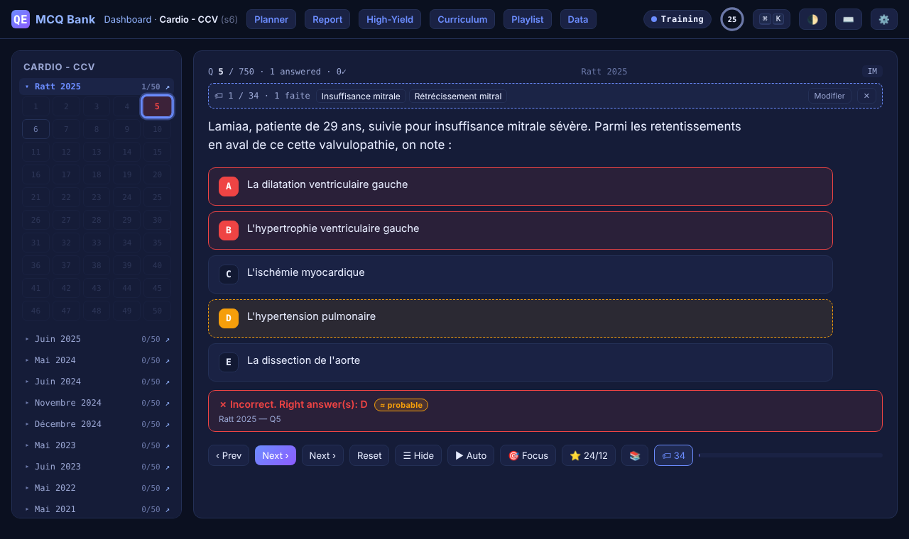

# qe — MCQ Question Bank

> Cram for med-school exams by blitzing ~15,500 real past-exam questions — all keyboard, all offline, no login.

**Quick start:** 1. download the repo as a ZIP and unzip it · 2. double-click `index.html` · 3. pick a module, press `1`–`5` to answer and `Space` to check.



## What it is

`qe` turns years of past medical-school exam papers (saved as plain `.txt` files) into a fast multiple-choice trainer. Pick your answers, get instant correction, drill one lesson of the curriculum at a time, and let it track the topics you keep getting wrong. It ships with 22 modules — 15,542 questions from 315 exams, semesters 5 to 10 of the FMPM (Marrakech) program — but it'll happily run on any questions in the same text format.

The one weird thing: **zero dependencies, no build step, no server.** No npm, no framework. Unzip it, double-click `index.html`, and it runs offline — questions and all. Your progress lives in your browser and never leaves it.

## Install & run

Nothing to install. Pick one:

```bash
# Option 1 — just open it (fully offline)
# Download the repo as a ZIP, unzip, and double-click index.html

# Option 2 — local server (nicer if you're editing the question files)
python3 -m http.server 8000
# then open http://localhost:8000/
```

Or use the live site, <https://achma-learning.github.io/qe/>, and hit your browser's **Install** button to keep it offline like an app.

No environment variables, no API keys, no accounts. The app never touches the network.

## Android app

Prefer a real app? **[⬇ Download the APK](https://github.com/achma-learning/qe/releases/latest/download/qe-bank-debug.apk)** — the same site wrapped in an offline WebView (package `online.qe.mcqbank`, no internet permission). Works on phones (opens in focus mode) and tablets (keeps the question sidebar). Allow "install unknown apps" for whatever opens the download, then open it.

In the app:
- **Volume buttons turn questions**, like pages in a reader: tap your answers, press **▼** to see the correction, **▼** again for the next question, **▲** to go back. No need to touch Check/Next at all. (Settings → "Volume buttons" to switch it off.)
- **⬇ Mettre à jour l'app** on the dashboard (and in Settings) downloads the newest version in your browser; open the file and it updates in place, progress kept.
- Buttons are laid out against mis-taps: Prev / Check / Next on their own big row, everything else further down, and Reset needs two taps.

> Coming from version 1.2 or older? Uninstall it first — older builds were signed with a different key, and Android refuses the update. Uninstalling clears your saved progress. From 1.3 on, updates install over the old version.

Source and build steps: [`android/README.md`](./android/README.md).

## Usage

Open `index.html` → the **dashboard** lists every module by semester. Type to search, or press a number, then `Enter`. Inside a module:

- `1`–`5` — toggle answer options · `Space` / `Enter` — check, press again for the next one
- `←` `→` — previous / next question
- `C` — **filter by lesson**: tick one or more lessons of the curriculum (or a whole sub-module) and drill only those. Each lesson shows how many questions it has and your accuracy, so weak lessons jump out. `Shift`+`C` clears it. On a phone, tap 🏷.
- `Z` — focus mode (everything but the question vanishes) · `A` — auto-advance. Both also have buttons under the question (on phones and tablets they sit in a lower row, away from Next, so they can't be hit by mistake).
- `W` (dashboard) — weakness analysis: accuracy per topic, weakest first

The one shortcut worth memorising: **`Ctrl`/`Cmd` + `K`** opens a command palette that jumps to any module or runs any command. `?` shows the full key map.

Two ways to study: **Training** (correction after every question) and **Exam** (answer a full paper, then get a /20 grade on the real FMPM scale plus a list of what you missed). Questions with no official answer key show a best estimate, clearly badged **≈ probable**.

Also in the top bar: **Report** (turns your mistakes into one prompt for an AI tutor), **High-Yield** (analysis documents per module), **Curriculum** (the S1–S10 program), **Planner** (activity heatmap + daily plan), **Playlist** and **Data** (links to courses and archives).

## Adding your own exams

The questions are just text files under `data/sX/` — edit one and either push it or rebuild locally (needs Node):

```bash
node tools/check-data.js      # flags typos that would silently drop a question
node tools/build-data.js      # bakes your edits in — then refresh the page
node tools/build-lessons.js   # re-tags questions with curriculum lessons
```

Push to `main` (even an edit straight on github.com) and a GitHub Action rebuilds and deploys the site, so the live website shows your new questions on its own. Full walkthrough + gotchas: **[how-to-add-new-exam.md](./how-to-add-new-exam.md)**.

## What's new

**Android app 1.5** — the 🎯 Focus button is back, in the lower row away from Next. 1.4 (same day) added volume buttons that move between questions, an in-app update button, and a touch layout that keeps your thumb off the wrong button. [Full changelog →](./CHANGELOG.md)

## Why I built this

I had years of past exam questions rotting in text files and no decent way to drill them — every quiz app wanted an account, a subscription, or wifi I didn't have. So I built the dumbest thing that works: one folder you open offline, drive entirely from the keyboard, that quietly remembers what you're bad at.

## License

No `LICENSE` file — this is a personal study project, so treat it as all-rights-reserved. The exam questions belong to their original authors (e-qe.online and the exam writers), not me.

## See also

- [`how-to-add-new-exam.md`](./how-to-add-new-exam.md) — the `.txt` format and its gotchas
- [`CHANGELOG.md`](./CHANGELOG.md) — what shipped when
- [`RELEASE.md`](./RELEASE.md) — every APK you can download, and how to roll back
- [`CONTEXT.md`](./CONTEXT.md) — for AI assistants joining the project
- [`docs/UX-AUDIT.md`](./docs/UX-AUDIT.md) — design notes and the roadmap
